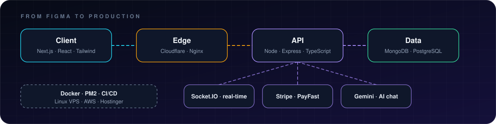
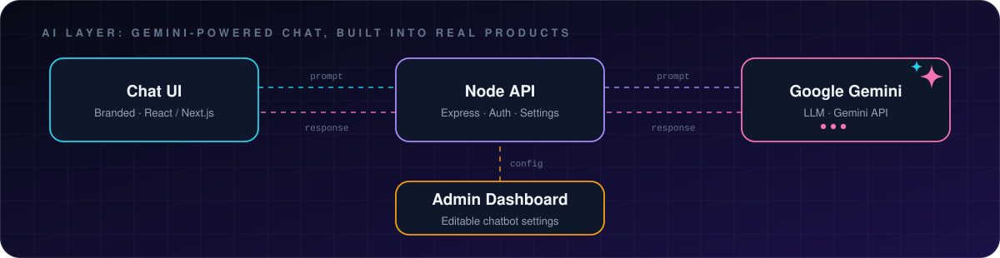
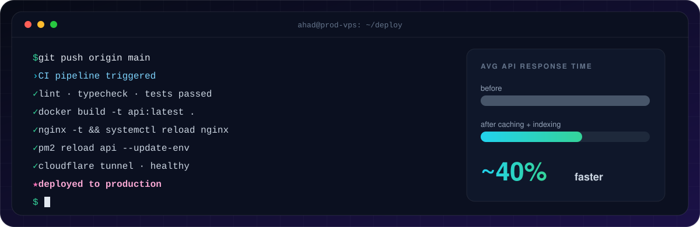

<div align="center">




<br/>

<a href="https://linkedin.com/in/ahad-hossain-aiman"></a>
<a href="mailto:ahad.aiman2@gmail.com"></a>
<a href="https://github.com/ahadhossainaiman?tab=followers"></a>


</div>

<br/>

## ⚡ whoami

<div align="center">
  
</div>

<br/>

## 🧭 How I Ship

<div align="center">
  
</div>

<br/>

## ⚙️ DevOps: Commit to Production

<div align="center">
  
</div>

<br/>

## 🤖 AI Layer

I integrate AI into real products, not demos. The SPORTAMINS chatbot runs on **Google Gemini** behind my own Node API, with a branded chat UI and settings the client can edit from the admin dashboard.

<div align="center">
  
</div>

<br/>

## 🖥️ Live from the Terminal

<div align="center">
  
</div>

<br/>

## 🛠️ Tech Arsenal

<div align="center">

**Frontend**<br/>


**Backend & Databases**<br/>


**DevOps & Cloud**<br/>


<br/>


</div>

<br/>

## 🚀 Featured Work

<table>
<tr>
<td width="50%" valign="top">

### 🏋️ SPORTAMINS
**UK sports nutrition brand platform · 2026**

A complete brand platform delivered live: website, API, admin CMS, and an AI chatbot, with full client handover.

- 3-app stack: **Next.js** site · **Express + MongoDB** API · **React/Vite** admin
- **SPORTI**, a Gemini-powered chatbot with dashboard-editable settings
- Learn/blog CMS, product pages, email pipeline, compliance + cookie flows
- Cloudflare Tunnel, PM2, safe production data seeding

`Next.js` `Node.js` `MongoDB` `Gemini` `Cloudflare` `PM2`

</td>
<td width="50%" valign="top">

### 🩺 DropDr
**Telemedicine & healthcare platform · 2024**

Live on the **App Store** and **Google Play**, connecting patients with doctors, nurses, therapists, and pharmacies.

- **6 isolated roles**, each with its own permissions and dashboard
- Booking, digital prescriptions, lab scheduling, medicine delivery
- OTP verification and JWT refresh-token rotation
- Real-time updates with Socket.IO

`Node.js` `TypeScript` `MongoDB` `Firebase` `Socket.IO` `JWT`

</td>
</tr>
</table>

<br/>

## 📈 Impact in Numbers

<div align="center">

| 🏗️ **30+** | ⏱️ **~40%** | 🔴 **500+** | 👥 **6** | 📱 **1** |
|:---:|:---:|:---:|:---:|:---:|
| production apps shipped | faster API responses | concurrent real-time connections | roles in one RBAC system | app live on both stores |

</div>

<br/>

## 💼 Journey

```text
2018 ─ 2022   🎓  B.Sc. in CSE, National University (Dhaka City College)
Sep 2023      🌱  Frontend Developer (Intern) @ Excel IT AI LTD: React, Next.js, Figma-to-code
Feb 2024      🚀  Senior Software Engineer @ Spark Tech Agency: full stack, DevOps, client delivery
2026          🤖  SPORTAMINS: 3-app brand platform with a Gemini-powered AI chatbot
Now           ⚡  Building what's next
```

<br/>

## 📊 GitHub Analytics

<div align="center">


</div>

<br/>

## 🐍 Contribution Snake

<div align="center">

<picture>
  <source media="(prefers-color-scheme: dark)" srcset="https://raw.githubusercontent.com/ahadhossainaiman/ahadhossainaiman/output/github-contribution-grid-snake-dark.svg"/>
  
</picture>

</div>

<br/>

## 🤝 Let's Build Something

I'm open to full stack products, AI-integrated apps, SaaS platforms, real-time systems, and backend/DevOps work. If you have an idea and need someone to take it from zero to live, let's talk.

<div align="center">

[](mailto:ahad.aiman2@gmail.com)
[](https://linkedin.com/in/ahad-hossain-aiman)

<sub>🗣️ Bangla (Native) · English (Professional Working)</sub>


</div>
